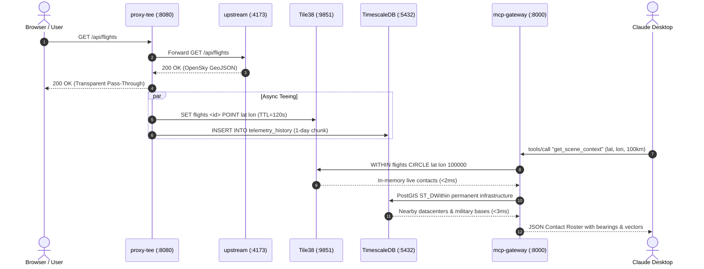

# Gods-Eye-View Sidecar: System Architecture

## 1. Executive Summary & Design Philosophy

The **Gods-Eye-View Sidecar** is a high-performance, non-invasive spatial intelligence, persistence, and AI automation companion to `bilawalsidhu/gods-eye-view`.

### The Upstream Isolation Contract
The foundational invariant of this project is **100% upstream code isolation**:
* **Zero Source Edits:** There are strictly **zero modifications** to upstream files (`src/`, `server/`, `package.json`, `vite.config.*`, `Dockerfile`, `compose.yaml`).
* **Clean Upstream Sync:** Running `git pull origin main` or `git merge upstream/main` will never generate merge conflicts.
* **Separation of Concerns:**
  * **Upstream** is the **Visual & OSINT Engine** (3D Cesium photoreal globe, GPU post-processing shaders, 25+ live global API proxies, OpenAI WebRTC voice HUD).
  * **Sidecar** is the **Memory, Analytics, and Automation Backbone** (sub-millisecond spatial geofencing in Tile38, 4D trajectory archiving in TimescaleDB, permanent infrastructure in PostGIS, local SGP4 orbital propagation, and dual-transport MCP federation for Claude Desktop).

---

## 2. End-to-End System Topology

```mermaid
flowchart TB
    subgraph Host ["User Host Machine (macOS / Linux)"]
        Browser["User Browser (Cesium 3D Globe)<br/>http://localhost:8080"]
        Claude["Claude Desktop / MCP Client<br/>(stdin / stdout)"]
    end

    subgraph DockerNetwork ["Docker Network: sidecar_net (172.28.0.0/16)"]
        subgraph UpstreamNamespace ["Upstream Network Namespace (Shared Pod)"]
            Upstream["upstream (Node 24 / Vite)<br/>Port 4173 (App) & 8000 (Forwarded)"]
            McpGateway["mcp-gateway (Python 3.11 / FastAPI)<br/>network_mode: service:upstream<br/>Dual SSE & STDIO Bridge"]
        end

        ProxyTee["proxy-tee (Node 20 / Express)<br/>Port 8080 (Published)<br/>IP: 172.28.0.10"]
        Tile38[("tile38 (In-Memory Hot Cache)<br/>Port 9851<br/>IP: 172.28.0.3")]
        TimescaleDB[("timescaledb (PostgreSQL 16 + PostGIS)<br/>Port 5432<br/>IP: 172.28.0.2")]
    end

    Browser <-->|HTTP / HTML + Script Injection| ProxyTee
    Browser <-->|WebSocket: /ws/copilot| McpGateway
    Claude <-->|docker exec stdio| McpGateway

    ProxyTee -->|Transparent Reverse Proxy| Upstream
    ProxyTee -.->|Async Tap / Enqueue| Tile38
    ProxyTee -.->|Async Batch Insert| TimescaleDB
    ProxyTee -.->|Headless Keep-Alive Cron| Upstream

    McpGateway <-->|Loopback MCP Proxy (127.0.0.1:4173)| Upstream
    McpGateway <-->|Sub-5ms Hot Spatial Queries| Tile38
    McpGateway <-->|4D Trajectory & Static Geobase| TimescaleDB
```

---

## 3. Container Fleet & Service Specifications

| Service | Image / Base | Ports | Network | Purpose |
| :--- | :--- | :--- | :--- | :--- |
| **`upstream`** | `node:24.14-slim` | `127.0.0.1:4173`<br>`127.0.0.1:8000` | `sidecar_net`<br>(`172.28.0.11`) | Core God's Eye View Vite app, 3D Cesium rendering, and 25+ upstream OSINT proxies. |
| **`proxy-tee`** | `node:20-alpine` | `127.0.0.1:8080` | `sidecar_net`<br>(`172.28.0.10`) | Non-invasive reverse proxy, HTML Co-Pilot bridge injector, telemetry tap, and headless keep-alive harvester. |
| **`mcp-gateway`** | `python:3.11-slim` | None (shares `upstream`) | `service:upstream` | Unified MCP Server (36 tools), SGP4 orbital engine, browser WebSocket hub, and spatial query router. |
| **`tile38`** | `tile38/tile38:latest` | `127.0.0.1:9851` | `sidecar_net` | Hot in-memory geospatial database. Sub-millisecond geofencing with 120s TTL. |
| **`timescaledb`** | `timescale/timescaledb-ha:pg16` | `127.0.0.1:5432` | `sidecar_net` | Cold 4D hypertable archive with columnar compression + Permanent PostGIS infrastructure geobase. |

---

## 4. Key Architectural Invariants & Bypass Mechanisms

### 1. Loopback-Pinned Upstream MCP Bypass
* **Upstream Restriction:** `server/mcp/plugin.js` checks `LOOPBACK_ADDRESSES.has(remoteAddress)` (`127.0.0.1, ::1`). It denies requests from any external Docker container IP with `403 Forbidden`.
* **Sidecar Solution:** `mcp-gateway` uses Docker Compose `network_mode: "service:upstream"`. Both containers share the identical network namespace, localhost loopback adapter, and routing tables. `mcp-gateway` talks to upstream via `http://127.0.0.1:4173/mcp` directly as a native loopback client. Port `8000` is mapped on `upstream` to expose the gateway to the host.

### 2. Same-Site Header Stripping (`admitSameSiteRequest`)
* **Upstream Restriction:** `server/providers/common/same-site.js` rejects requests containing proxy headers (`x-forwarded-for`, `via`, `forwarded`) with `403 Proxied requests are not accepted`.
* **Sidecar Solution:** `proxy-tee` aggressively strips all forwarded headers in `proxyReq` before sending to upstream, and rewrites `Host: localhost:4173` and `Origin: http://localhost:4173`. Upstream validates all incoming requests as native same-site calls.

### 3. Key Setup Remote Peer Check (`admitKeySetupRequest`)
* **Upstream Restriction:** `server/standalone/key-setup.js` strictly checks that connecting IPs are either loopback or listed in `GEV_KEY_SETUP_TRUSTED_PEERS`.
* **Sidecar Solution:** `proxy-tee` is allocated static internal IP `172.28.0.10`, and `upstream` is initialized with `GEV_KEY_SETUP_TRUSTED_PEERS: 172.28.0.10,127.0.0.1`. The "POWER UP" modal functions seamlessly.

---

## 5. Storage Tiering & Data Flow



### Storage Tiers Breakdown:
1. **Hot Transient Tier (Tile38):**
   * Stores live aircraft, ships, and active wildfire hotspots.
   * Auto-eviction using rolling TTL (120s for vehicles, 1800s for fires).
   * Memory ceiling: ~15 MB – 50 MB total RAM.
2. **Cold Temporal Archive Tier (TimescaleDB `telemetry_history`):**
   * Stores historical fixes partitioned into 1-day hypertable chunks.
   * Columnar compression enabled for data older than 24 hours (85–90% reduction).
   * Automatic 30-day retention policy drops chunks older than 30 days. Steady-state disk: ~4.5 GB – 5.5 GB.
3. **Permanent Static Geobase Tier (PostGIS `static_infrastructure`):**
   * Stores fixed world assets (datacenters, dams, submarine cables, landing stations, military installations).
   * Non-expiring (infinite retention), indexed with PostGIS 2D R-Tree (GIST).
   * Total disk size: ~30 MB for 44,131 global assets.

---

## 6. Resilience & Failure Domains

* **Transient Upstream Restarts:** When keys are saved in upstream's settings modal, upstream triggers `server.restart()` with a 1-2 second connection drop. `proxy-tee` intercepts socket errors and returns `503 UPSTREAM_RESTARTING` rather than crashing or terminating connections.
* **Headless Autonomy:** When no user browser is active, `proxy-tee` automatically steps down to Headless Mode after 60 seconds, activating an internal governor that queries flights (15s), vessels (30s), fires (30m), and satellites (6h) to prevent data gaps in the TimescaleDB archive.
* **STDIO Bridge Isolation:** Claude Desktop connects via `docker exec -i gods-eye-view-mcp-gateway-1 python3 -m src.mcp_stdio`. All application and diagnostic logging is redirected strictly to `sys.stderr`, guaranteeing that `sys.stdout` remains pristine for JSON-RPC messages.
