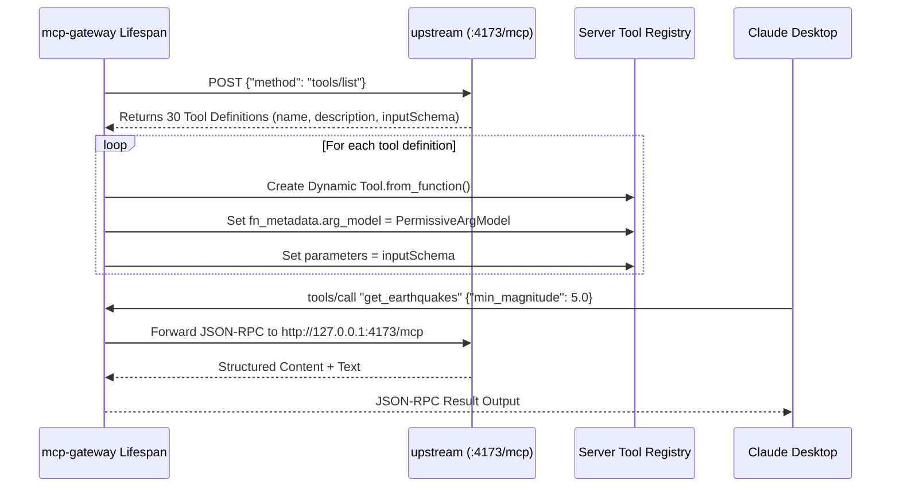
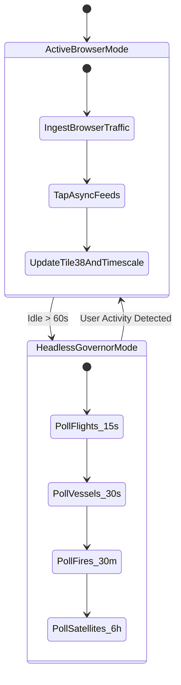

# Gods-Eye-View Sidecar: Technical Design Specification

## 1. Dynamic MCP Tool Federation Engine

### Problem & Challenge
Upstream God's Eye View provides 30 built-in MCP tools in `server/mcp/plugin.js`. However:
1. Upstream loopback restrictions prevent external containers or remote clients from querying `/mcp`.
2. Hardcoding 30 tool functions into Python creates severe maintenance debt that breaks whenever upstream adds or updates a tool.
3. Standard Pydantic argument models in MCP 2.x reject arbitrary arguments with validation errors (`Extra inputs are not permitted`).

### Architectural Solution
We built a dynamic reflection and federation engine in [`upstream_tools.py`](file:///Users/var/Documents/Projects/antigravity/gods-eye-view/sidecar/mcp-gateway/src/upstream_tools.py):

```python
class PermissiveArgModel(ArgModelBase):
    model_config = ConfigDict(extra="allow")

    def model_dump_one_level(self):
        res = dict(self.__dict__)
        if hasattr(self, "__pydantic_extra__") and self.__pydantic_extra__:
            res.update(self.__pydantic_extra__)
        return res
```

#### Federation Workflow:


---

## 2. Multi-Tier Spatio-Temporal Storage Engine

```
               [ Incoming Ingestion Stream ]
                             |
             +---------------+---------------+
             |                               |
             v                               v
    [ Hot Spatial Tier ]           [ Cold Archive Tier ]
       Tile38 (RAM)                TimescaleDB (Hypertable)
  - Point (lat, lon, alt)        - Partitioned by 1-day chunks
  - 120s Rolling TTL             - H3 Hexagonal Indexes (res 5/9)
  - Sub-5ms Geofencing           - Columnar compression >24h
  - Ephemeral memory cap         - 30-day retention drop policy
```

### 1. Tile38 In-Memory Hot Geofencing
* **Command Signature:** `SET <layer> <entity_id> FIELD alt <alt> FIELD hdg <hdg> FIELD spd <spd> EX <ttl> POINT <lat> <lon>`
* **Spatial Primitives:**
  * Radius Roster: `WITHIN <layer> CIRCLE <lat> <lon> <radius_m>`
  * Boundary Search: `INTERSECTS <layer> BOUNDS <minLat> <minLon> <maxLat> <maxLon>`
* **Auto-Eviction:** Keys self-expire after 120s (aircraft/vessels) or 1800s (fires), preventing memory leaks.

### 2. TimescaleDB 4D Telemetry Hypertable (`telemetry_history`)
* **Partitioning:** Created with `create_hypertable('telemetry_history', 'ts', chunk_time_interval => INTERVAL '1 day')`.
* **Spatial Indexing:** Dual H3 hexagonal indexing + PostGIS Geography:
  * `h3_res5`: Coarse macro-region (cell size ~252 km²).
  * `h3_res9`: Fine micro-cell (cell size ~0.1 km²).
  * `geom`: 3D Geography Point (`PointZ, 4326`) indexed via PostGIS GIST.
* **Columnar Compression:**
  ```sql
  ALTER TABLE telemetry_history SET (
      timescaledb.compress,
      timescaledb.compress_segmentby = 'layer, h3_res5',
      timescaledb.compress_orderby = 'ts DESC'
  );
  SELECT add_compression_policy('telemetry_history', INTERVAL '24 hours');
  ```
  Reduces historical row footprint from ~380 bytes to ~32 bytes per fix (85–92% compression).

### 3. Permanent PostGIS Static Infrastructure (`static_infrastructure`)
* **Polymorphic Design:** Handles points (datacenters, dams), line strings (submarine cables), and polygons (facility boundaries) in a single unified schema.
* **Non-Expiring:** Never subjected to retention policies.
* **Performance:** Indexed via PostGIS GIST R-Tree, answering 50km radius containment queries over 44,000+ facilities in under 5 milliseconds.

---

## 3. SGP4 Orbital Engine & Topocentric Geodesy

The sidecar includes an embedded, high-performance C++ compiled SGP4 orbital propagator ([`sgp4_engine.py`](file:///Users/var/Documents/Projects/antigravity/gods-eye-view/sidecar/mcp-gateway/src/sgp4_engine.py)):

### Coordinate Transformation Pipeline:
1. **SGP4 Propagation:** TLE lines $\rightarrow$ True Equator, Mean Equinox (TEME) Cartesian vectors $\mathbf{r}_{\text{TEME}} = (x, y, z), \mathbf{v}_{\text{TEME}} = (\dot{x}, \dot{y}, \dot{z})$.
2. **TEME $\rightarrow$ ECEF Transformation:** Rotated by Greenwich Mean Sidereal Time ($\theta_{\text{GMST}}$):
   $$\begin{pmatrix} x_{\text{ECEF}} \\ y_{\text{ECEF}} \\ z_{\text{ECEF}} \end{pmatrix} = \begin{pmatrix} \cos\theta & \sin\theta & 0 \\ -\sin\theta & \cos\theta & 0 \\ 0 & 0 & 1 \end{pmatrix} \begin{pmatrix} x_{\text{TEME}} \\ y_{\text{TEME}} \\ z_{\text{TEME}} \end{pmatrix}$$
3. **Topocentric Look-Angle Calculation:**
   Vectors from observer position to satellite transformed into South-East-Zenith (SEZ) frame:
   * **Azimuth:** $\text{Az} = \text{atan2}(E, -S) \pmod{360^\circ}$
   * **Elevation:** $\text{El} = \arcsin\left(\frac{Z}{\|\mathbf{\rho}\|}\right)$
   * **Slant Range:** $\rho = \|\mathbf{r}_{\text{sat}} - \mathbf{r}_{\text{obs}}\|$

---

## 4. Bi-Directional Browser Co-Pilot WebSocket Bridge

```
[ Browser Client ]  <--- injected ---> [ copilot-bridge.js ]
                                                |
                                            WebSocket
                                                |
                                                v
[ MCP Gateway ]     <--- hub.send_command() <-- [ ws_copilot.py Hub ]
```

### Injection & Discovery Protocol:
1. **HTML Modification:** When the browser requests `http://localhost:8080`, `proxy-tee` intercepts the HTML response and injects:
   ```html
   <script src="/__sidecar/copilot-bridge.js" defer></script>
   ```
2. **Cesium Viewer Hook:** `copilot-bridge.js` polls every 250ms for `window.viewer` or `window.__godsEyeView` Cesium instances.
3. **Command Execution Handlers:**
   * `fly_to_coordinate`: `camera.flyTo({ destination: Cartesian3.fromDegrees(lon, lat, alt), duration })`.
   * `select_entity`: Dispatches synthetic picked context events to highlight aircraft/vessels.
   * `toggle_layer`: Toggles visibility on specific primitive collections.
   * `set_time_replay_mode`: Switches viewer clock between real-time stream and historical playback buffer.

---

## 5. Headless Keep-Alive Harvester State Machine



* **Activity Tracking:** Every request passing through `proxy-tee` updates `lastClientActivity = Date.now()`.
* **Headless Transition:** If no user traffic is received for 60 seconds, the background governor activates polling tasks respecting provider rate limits (Flights: 15s, Vessels: 30s, FIRMS: 30m, CelesTrak: 6h).
* **Instant Disarm:** The moment a user re-opens or navigates `http://localhost:8080`, background polling suspends immediately to conserve provider quotas.
