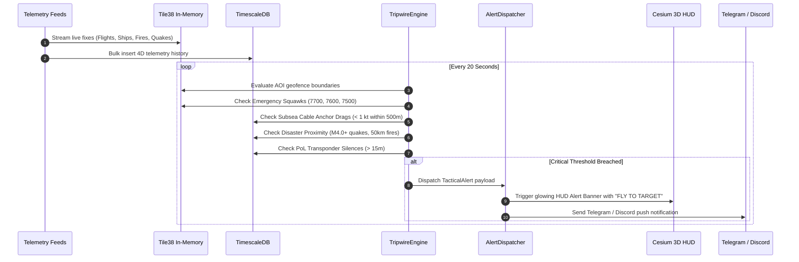

# Gods-Eye-View Sidecar: Comprehensive Feature Catalog & Capabilities Specification

> **A Sovereign Personal C6ISR (Command, Control, Communications, Computers, Cyber, Cognitive, Intelligence, Surveillance, Reconnaissance) Platform**  
> *Current Release: `v1.12.0-sidecar` | 70 MCP Tools | Multi-Entity Dynamic Escort Bubble Engine | 100% Upstream Isolated*

---

## 1. Executive Feature Overview

The Gods-Eye-View Sidecar extends the Gods-Eye-View 3D geospatial engine into an autonomous, proactive personal intelligence sentinel. While upstream Gods-Eye-View acts as a visual browser globe, the Sidecar injects an enterprise multi-tier spatio-temporal data pipeline, an autonomous background watchstander daemon, kinematic vector analytics, line-of-sight radar physics, sovereign edge radio ingestion, real-time Cursor-on-Target (CoT) tactical data link streaming to mobile ATAK-CIV, long-range off-grid Meshtastic LoRa radio mesh relays, and a **Multi-Entity Dynamic Escort Bubble Engine** that moves with your phone or vehicle anywhere on Earth.

```mermaid
flowchart TB
    subgraph DataSources ["Multi-INT Telemetry Ingestion"]
        S1["OpenSky / adsb.lol (1090MHz ADS-B)"]
        S2["AIS Marine Hubs (VHF Maritime)"]
        S3["CelesTrak (TLE Orbital Ephemerides)"]
        S4["NASA FIRMS (Thermal Hotspots)"]
        S5["USGS (Global Seismic Sensors)"]
        S6["NOAA / GFS (Atmospheric Weather)"]
        S7["Physical RTL-SDR ($30 USB Dongle RF)"]
        S8["Meshtastic LoRa Field Nodes (865/868/915MHz)"]
        S9["Personal Mobile GPS / ATAK PLI (Live Escort Fixes)"]
    end

    subgraph StorageTiers ["Spatio-Temporal Memory Stack"]
        T1["Tile38 Hot In-Memory Geo-Cache<br/>(120s TTL, RESP2 Redis protocol)"]
        T2["TimescaleDB 4D Telemetry Archive<br/>(30-Day Hypertable, 1-day chunks, H3 indices)"]
        T3["PostGIS Static Critical Infrastructure<br/>(44,131 datacenters, dams, cables, military bases)"]
    end

    subgraph ProcessingEngines ["Autonomous Sentinel Engines"]
        E1["TripwireEngine (20s Sentinel Loop)"]
        E2["IntsumEngine (12h Intelligence Dossiers)"]
        E3["KinematicsEngine (4D CPA / TCPA Vectors)"]
        E4["PolEngine (Dark Vessel & Silence Detector)"]
        E5["RadarEngine (4/3 Earth Curvature Horizons)"]
        E6["SdrEngine (Sovereign 1090MHz/162MHz Feeder)"]
        E7["CotEngine (ATAK / CoT 2.0 UDP Broadcaster)"]
        E8["MeshtasticEngine (LoRa Off-Grid Mesh Relay)"]
        E9["PersonalEscortEngine (Dynamic Multi-Bubble Guardian)"]
    end

    subgraph Dispatches ["Multi-Channel Command & Control"]
        C1["Cesium 3D HUD (Real-time Alert Banners & Flying Camera)"]
        C2["macOS Native Desktop Notifications (osascript)"]
        C3["Telegram Bot Push Notifications"]
        C4["Discord Webhooks (#tactical-alerts)"]
        C5["Slack Webhooks (#defense-ops)"]
        C6["ATAK-CIV / WinTAK / iTAK Mobile Mesh (UDP :4242)"]
        C7["Meshtastic Decentralized LoRa Radios (Off-Grid Mesh)"]
        C8["70 MCP Tools (Claude Desktop / Cursor / Windsurf)"]
    end

    DataSources --> StorageTiers
    StorageTiers --> ProcessingEngines
    ProcessingEngines --> Dispatches
```



---

## 2. Feature Matrix & Version History

| Release Tag | Phase / Milestone | Core Capabilities Added | Native Tools | Total Tools |
| :--- | :--- | :--- | :--- | :--- |
| **`v1.3.0-sidecar`** | **Phase 1: Ingestion & Storage Tier** | • Zero-overhead `proxy-tee` transparent telemetry tap.<br/>• Sub-millisecond Tile38 hot in-memory geofencing.<br/>• TimescaleDB compressed hypertable 4D archive.<br/>• PostGIS static infrastructure geobase (44,131 assets).<br/>• Bi-directional `/ws/copilot` WebSocket bridge to Cesium.<br/>• SGP4 headless topocentric satellite pass prediction. | 6 | **36** |
| **`v1.4.0-sidecar`** | **Phase 2: Tactical Tripwires & Alerts** | • Default Bangalore Tactical AOI & Watchlist Registry.<br/>• Autonomous `TripwireEngine` (20-second evaluation loop).<br/>• Squawk emergency detection (`7700`, `7600`, `7500`).<br/>• Low-altitude infrastructure incursions & cable anchor drag.<br/>• Unified multi-channel alert dispatcher (HUD, Desktop, Telegram, Discord, Slack). | 10 | **40** |
| **`v1.5.0-sidecar`** | **Phase 3.1 & 3.2: AI Watchstander** | • Autonomous 12-hour INTSUM Intelligence Dossiers.<br/>• Automated executive briefing push to webhooks/chat.<br/>• 3D glowing cyan AOI perimeter rings with tactical badges.<br/>• Dynamic AOI radius rendering in Cesium canvas. | 12 | **42** |
| **`v1.6.0-sidecar`** | **Phase 4.1: Kinematic CPA / TCPA** | • 4D Closest Point of Approach (CPA) geometric solver.<br/>• Time-to-CPA (TCPA) in seconds & closing velocities.<br/>• Proximity separation conflict scanner (TCAS-style).<br/>• Real-time Tile38 hot cache entity anchor lookups. | 14 | **44** |
| **`v1.7.0-sidecar`** | **Phase 3.3: Pattern-of-Life (PoL)** | • Non-cooperative dark contact & transponder silence detector.<br/>• Sudden mid-air loss detection (> 1,000m / > 140 kts).<br/>• Dark vessel maritime chokepoint silence detection (> 2.0 kts).<br/>• Kinematic flight maneuver anomaly detector (> 3,500 fpm descents). | 16 | **46** |
| **`v1.8.0-sidecar`** | **Phase 4.2: 3D Radar Horizons** | • Standard 4/3 effective Earth radius atmospheric refraction physics.<br/>• Radar horizon calculation: $d \approx 4.12 \times (\sqrt{h_{\text{radar}}} + \sqrt{h_{\text{target}}})$.<br/>• True 3D slant range & elevation angle spherical geometry.<br/>• Overhead cone of silence & horizon shadow detection.<br/>• 3D translucent radar domes, range rings & azimuth radials in Cesium. | 20 | **50** |
| **`v1.9.0-sidecar`** | **Phase 4.3: Sovereign Edge SDR Ingestion** | • Plug-and-play RTL-SDR USB receiver ($30 hardware dongle).<br/>• 1090MHz ADS-B Mode-S & 162MHz Marine AIS radio reception.<br/>• Tri-mode ingest: `synthetic_rf`, `tcp_sbs` (port 30003), `http_json`.<br/>• Standalone feeder container (`sidecar/sdr/`).<br/>• 100% offline, unjammable sovereign tracking bubble. | 25 | **55** |
| **`v1.10.0-sidecar`** | **Phase 4.4: ATAK / CoT Tactical Data Link** | • Cursor-on-Target (CoT 2.0 XML) serialization engine.<br/>• Sub-second UDP broadcast (`255.255.255.255:4242`) and unicast targets.<br/>• MIL-STD-2525 symbol mappings (civil/military air, sea, radar, AOIs).<br/>• Instant emergency 911 alerts (`t-x-d-a`) for 7700 squawks & Sentinel tripwires.<br/>• Civilian situational awareness on ATAK-CIV Android mobile devices worldwide. | 30 | **60** |
| **`v1.11.0-sidecar`** | **Phase 4.5: Meshtastic / LoRa Tactical Relay** | • Off-grid LoRa radio mesh relay (865MHz IN, 868MHz EU, 915MHz US).<br/>• Decentralized field node discovery & live telemetry (GPS, SNR, Battery %).<br/>• Auto-forwarding critical Sentinel alerts over the mesh to handheld radios.<br/>• Ingestion into Tile38 & ATAK CoT as Friendly Ground Units (`a-f-G-U-C`).<br/>• Tri-mode support: `synthetic_mesh`, `tcp` (port 4403), `serial` (`/dev/ttyUSB0`). | 35 | **65** |
| **`v1.12.0-sidecar`** | **Phase 4.6: Multi-Entity Dynamic Escort Bubbles** | • Dynamic moving protective bubbles around tagged personal phones, team members, or vehicles.<br/>• Live GPS ingestion via mobile ping, ATAK PLI, or LoRa tracking.<br/>• Spatial Q&A relative to moving member: nearest dams, military installations, hospitals.<br/>• Geodesic travel corridor hazard evaluation (hazard avoidance clearances).<br/>• Proactive Guardian Sentinel alerts for bubble perimeter breaches. | **40** | **70** |

---

## 3. Complete MCP Tool Catalog (70 Tools)

All 70 tools are exposed via dual transports:
1. **Model Context Protocol (MCP)** via SSE (`/mcp/sse`) and stdio (`python -m src.mcp_stdio`) for Claude Desktop, Cursor, and Windsurf.
2. **REST API** via HTTP `POST /api/tools/{tool_name}` for scripts, curl, or webhooks.

### Section A: Native Sidecar Intelligence & Surveillance Tools (25 Tools)

#### 1. `resolve_anchor`
* **Purpose:** Resolves a query string (place name, airport ICAO/IATA code, aircraft callsign, maritime MMSI, or coordinates) into a precise 4D coordinate fix.
* **Algorithm:** Performs a two-hop resolution. Checks the local geocoding cache first, then checks the live Tile38 hot in-memory cache, and finally searches TimescaleDB historical records with `ILIKE`.
* **Parameters:**
  * `query` *(string, required)*: Place name, airport code, callsign, MMSI, or coordinates.
  * `timestamp` *(string, optional)*: ISO 8601 timestamp for historical coordinate reconstruction.
* **Sample Request:**
  ```json
  { "query": "VOBL" }
  ```
* **Sample Response:**
  ```json
  {
    "type": "geographic",
    "query": "VOBL",
    "resolved_name": "Bengaluru International Airport (VOBL)",
    "lat": 13.2001,
    "lon": 77.7088,
    "altitude_m": 915.0,
    "timestamp": "2026-10-18T13:30:00Z"
  }
  ```

#### 2. `get_scene_context`
* **Purpose:** Returns a distance-ranked Contact Roster within a specified radius around a coordinate fix, enriched with closing/receding vector status, compass bearing, overhead satellite look angles, and environmental weather.
* **Routing:** Automatically queries **Tile38** if `timestamp == "now"`, or **TimescaleDB** if historical.
* **Parameters:**
  * `lat` *(float, required)*: Observer latitude.
  * `lon` *(float, required)*: Observer longitude.
  * `radius_km` *(float, default: 50.0)*: Scan radius in kilometers.
  * `timestamp` *(string, default: "now")*: ISO timestamp or `"now"`.
  * `layers` *(array of strings, default: `["flights", "vessels", "military"]`)*: Active target layers.

#### 3. `get_entity_trajectory`
* **Purpose:** Reconstructs the full 4D trajectory history of an entity across a time window.
* **Parameters:**
  * `entity_id` *(string, required)*: Unique identifier (hex code, MMSI, NORAD ID).
  * `start_time` *(string, required)*: ISO timestamp start.
  * `end_time` *(string, required)*: ISO timestamp end.

#### 4. `predict_satellite_passes`
* **Purpose:** Headless SGP4 orbital propagator calculating upcoming satellite passes and topocentric look-angles (azimuth, elevation, slant range) over an observer location.
* **Parameters:**
  * `lat` *(float, required)*: Ground station latitude.
  * `lon` *(float, required)*: Ground station longitude.
  * `duration_hours` *(float, default: 6.0)*: Lookahead window in hours.
  * `min_elevation_deg` *(float, default: 20.0)*: Minimum acquisition-of-signal (AOS) elevation angle.

#### 5. `control_visual_cockpit`
* **Purpose:** Transmits real-time flight, camera lock, layer toggle, or entity selection commands to the active Cesium browser UI over the `/ws/copilot` WebSocket bridge.
* **Parameters:**
  * `action` *(string, required)*: `fly_to_coordinate`, `select_entity`, `toggle_layer`, `set_time_replay_mode`.
  * `params` *(object, required)*: Action-specific payload (e.g. `lat`, `lon`, `altitude_m`, `duration`).

#### 6. `get_active_viewport`
* **Purpose:** Queries the live Cesium browser session to retrieve the user's active camera latitude, longitude, altitude, heading, pitch, and roll.
* **Parameters:** None.

#### 7. `find_static_infrastructure`
* **Purpose:** Spatial query against the PostGIS static geobase (44,131 assets) for critical infrastructure nodes.
* **Parameters:**
  * `lat` *(float, required)*: Center latitude.
  * `lon` *(float, required)*: Center longitude.
  * `radius_km` *(float, default: 50.0)*: Search radius in km.
  * `category` *(string, default: "all")*: `submarine_cable`, `datacenter`, `power_plant`, `dam`, `military_base`.
  * `limit` *(int, default: 50)*: Maximum returned records.

#### 8. `get_active_alerts`
* **Purpose:** Retrieves the most recent tactical alerts logged by the autonomous Sentinel engine.
* **Parameters:**
  * `limit` *(int, default: 20)*: Number of alerts to return.

#### 9. `test_tactical_alert`
* **Purpose:** Manually dispatches a synthesized tactical alert across all enabled notification channels (Cesium HUD banner, macOS desktop notification, Telegram, Discord, Slack, and database log).
* **Parameters:**
  * `title` *(string, required)*: Alert title.
  * `severity` *(string, required)*: `INFO`, `LOW`, `MEDIUM`, `WARNING`, `HIGH`, `CRITICAL`.
  * `message` *(string, required)*: Alert body text.
  * `category` *(string, default: "SYSTEM")*: Event category.
  * `aoi_name` *(string, optional)*: Associated Area of Interest.
  * `entity_id` *(string, optional)*: Associated contact ID.
  * `lat` *(float, optional)*: Latitude for one-click HUD flight camera centering.
  * `lon` *(float, optional)*: Longitude for one-click HUD flight camera centering.

#### 10. `get_aois`
* **Purpose:** Returns all registered Areas of Interest (AOIs) with geographical perimeters, radii, and assigned airport corridors.
* **Parameters:** None.

#### 11. `add_aoi`
* **Purpose:** Dynamically registers a new Area of Interest in the Sentinel watchlist and broadcasts updated perimeter rings to all active Cesium cockpits.
* **Parameters:**
  * `name` *(string, required)*: Unique name for the AOI.
  * `lat` *(float, required)*: Center latitude.
  * `lon` *(float, required)*: Center longitude.
  * `radius_km` *(float, default: 50.0)*: Surveillance boundary radius in kilometers.
  * `description` *(string, default: "")*: Operational description.
  * `airports` *(array of strings, default: `[]`)*: Exempt airport ICAO codes.

#### 12. `generate_intelligence_summary`
* **Purpose:** Synthesizes an executive Intelligence Summary (INTSUM) dossier for an AOI over a designated time window.
* **Parameters:**
  * `aoi_name` *(string, default: "Bangalore")*: AOI to analyze.
  * `hours` *(int, default: 12)*: Historical analysis window in hours.

#### 13. `dispatch_intelligence_summary`
* **Purpose:** Generates an INTSUM dossier and immediately pushes it formatted in Markdown to all enabled external channels (Telegram, Discord, Slack).
* **Parameters:**
  * `aoi_name` *(string, default: "Bangalore")*: Target AOI.
  * `hours` *(int, default: 12)*: Analysis window.

#### 14. `toggle_aoi_perimeters`
* **Purpose:** Toggles or sets the visibility of 3D glowing cyan AOI perimeter rings and tactical geofence beacons in the Cesium browser globe.
* **Parameters:**
  * `visible` *(boolean, optional)*: Force visible (`true`), hidden (`false`), or toggle if omitted.

#### 15. `calculate_cpa_intercept`
* **Purpose:** Calculates 4D Closest Point of Approach (CPA), Time-to-CPA (TCPA) in seconds, and closing velocity between two aircraft or vessels.
* **Parameters:**
  * `entity_a_id` *(string, required)*: First contact ID or callsign.
  * `entity_b_id` *(string, required)*: Second contact ID or callsign.

#### 16. `scan_proximity_conflicts`
* **Purpose:** Radar separation conflict scanner: detects converging aircraft pairs violating minimum distance thresholds or inbound on AOI intercept trajectories.
* **Parameters:**
  * `lat` *(float, required)*: Scan center latitude.
  * `lon` *(float, required)*: Scan center longitude.
  * `radius_km` *(float, default: 100.0)*: Airspace scan radius.
  * `min_cpa_km` *(float, default: 5.0)*: Separation minimum threshold (TCAS alert boundary).
  * `max_tcpa_min` *(float, default: 15.0)*: Lookahead time window in minutes.

#### 17. `detect_dark_contacts`
* **Purpose:** Identifies non-cooperative dark contacts whose transponders ceased broadcasting while airborne (> 1,000m / > 140 kts) or underway at sea (> 2.0 kts) near AOIs or subsea cable zones.
* **Parameters:**
  * `aoi_name` *(string, default: "Bangalore")*: Target AOI to inspect.
  * `silence_window_min` *(int, default: 15)*: Silence duration required to classify as dark contact.
  * `layer` *(string, default: "all")*: Filter by `flights`, `vessels`, or `all`.

#### 18. `detect_maneuver_anomalies`
* **Purpose:** Analyzes consecutive waypoint delta vectors in TimescaleDB to detect severe kinematic anomalies (rapid uncoordinated descents $> 3,500\text{ fpm}$, high-G erratic turns) outside airport corridors.
* **Parameters:**
  * `aoi_name` *(string, default: "Bangalore")*: Target AOI.
  * `max_descent_rate_fpm` *(float, default: 3500.0)*: Maximum allowed descent threshold in feet per minute.

#### 19. `get_radar_stations`
* **Purpose:** Lists operational military and civilian surveillance radar stations with antenna heights, frequency bands, instrumented ranges, and calculated horizons (at ground, 300m low altitude, 3,000m approach, and 10,000m FL330 cruise).
* **Parameters:**
  * `enabled_only` *(boolean, default: true)*: Filter active stations only.

#### 20. `evaluate_radar_coverage`
* **Purpose:** Evaluates line-of-sight radar visibility, horizon shadow due to 4/3 Earth curvature, slant range, elevation angle, and overhead cone-of-silence blind zones for any target coordinate and altitude.
* **Parameters:**
  * `lat` *(float, required)*: Target latitude.
  * `lon` *(float, required)*: Target longitude.
  * `altitude_m` *(float, default: 1000.0)*: Target altitude in meters above sea level.
  * `station_id` *(string, optional)*: Specific station ID to evaluate, or all stations if omitted.

#### 21. `evaluate_entity_radar_coverage`
* **Purpose:** Resolves an active tracked aircraft or vessel and evaluates its real-time radar coverage status across all surveillance stations.
* **Parameters:**
  * `entity_id` *(string, required)*: Target contact ID, callsign, or MMSI.

#### 22. `render_radar_domes`
* **Purpose:** Dispatches a command to the Cesium browser UI to dynamically render 3D translucent hemispherical radar coverage envelopes, tactical concentric range rings, and azimuth radials.
* **Parameters:**
  * `enabled` *(boolean, default: true)*: Show (`true`) or hide (`false`) radar domes.
  * `station_id` *(string, optional)*: Specific station to display, or all stations.

#### 23. `get_sdr_status`
* **Purpose:** Checks sovereign edge SDR receiver status, active frequency (1090MHz ADS-B / 162MHz AIS), message rates (msg/sec), and active local RF contact counts.
* **Parameters:** None.

#### 24. `configure_sdr_receiver`
* **Purpose:** Configures sovereign edge SDR receiver operating modes (`synthetic_rf`, `tcp_sbs`, `http_json`), host/IP, port, frequency, or polling intervals.
* **Parameters:**
  * `mode` *(string, optional)*: `synthetic_rf`, `tcp_sbs`, `http_json`.
  * `station_name` *(string, optional)*: Station identifier.
  * `frequency_mhz` *(float, optional)*: Tuned frequency in MHz (e.g. 1090.0 or 162.0).
  * `source_host` *(string, optional)*: Hostname/IP of SBS or readsb feed.
  * `source_port` *(int, optional)*: TCP port (default 30003).
  * `http_url` *(string, optional)*: HTTP URL for `aircraft.json`.
  * `poll_interval_sec` *(float, optional)*: Polling interval in seconds.

#### 25. `start_sdr_stream` & `stop_sdr_stream` & `get_sdr_contacts`
* **Purpose:** Starts, stops, or retrieves active contacts from the local sovereign edge SDR receiver. Contacts include RF signal strength (`rssi_dbfs`) and message counts.

#### 26. `get_cot_status`
* **Purpose:** Checks Cursor-on-Target (CoT) / ATAK broadcaster metrics, transmission rate (Hz), total packets sent, and active broadcast/unicast targets.
* **Parameters:** None.

#### 27. `configure_cot_broadcaster`
* **Purpose:** Configures CoT / ATAK broadcaster UDP target host, port (default 4242), unicast phone IPs, stale offsets, or streaming intervals.
* **Parameters:**
  * `enabled` *(boolean, optional)*: Master toggle for background CoT streaming.
  * `target_host` *(string, optional)*: Subnet broadcast IP (e.g. `255.255.255.255`).
  * `target_port` *(int, optional)*: UDP port (standard ATAK port is `4242`).
  * `unicast_targets` *(list of strings, optional)*: Specific Android device IP addresses.
  * `broadcast_interval_sec` *(float, optional)*: Broadcast rate in seconds (default `3.0`).
  * `stale_offset_sec` *(int, optional)*: Time before contacts expire in ATAK if not refreshed (default `60`).

#### 28. `start_cot_stream`
* **Purpose:** Starts the background CoT streaming daemon, pushing real-time MIL-STD-2525 tracks to all ATAK, WinTAK, and iTAK endpoints on the network.
* **Parameters:** None.

#### 29. `stop_cot_stream`
* **Purpose:** Stops the CoT / ATAK UDP broadcast stream and releases network sockets.
* **Parameters:** None.

#### 30. `broadcast_cot_test_marker`
* **Purpose:** Broadcasts an immediate test CoT marker with custom callsign, coordinates, and remarks to verify phone connectivity and map rendering.
* **Parameters:**
  * `callsign` *(string, default: "TEST_PIN")*: Marker label.
  * `lat` *(float, default: 12.9716)*: Target latitude.
  * `lon` *(float, default: 77.5946)*: Target longitude.
  * `altitude_m` *(float, default: 1500.0)*: Altitude in meters (HAE).
  * `remarks` *(string, optional)*: Detailed text shown in the ATAK radial contact card.
  * `cot_type` *(string, default: "a-f-A-C-F")*: MIL-STD-2525 type code.

#### 31. `get_meshtastic_status`
* **Purpose:** Checks Meshtastic / LoRa off-grid tactical relay operational status, tuned frequency band (e.g. IN865 / EU868 / US915), modem preset (`LONG_FAST`), and mesh packet statistics.
* **Parameters:** None.

#### 32. `get_mesh_nodes`
* **Purpose:** Discovers all active Meshtastic field nodes, mobile rovers, repeater towers, live GPS coordinates, battery levels, and SNR signal quality across the radio mesh.
* **Parameters:** None.

#### 33. `configure_meshtastic_relay`
* **Purpose:** Reconfigures LoRa mesh parameters dynamically, including operating mode (`synthetic_mesh`, `tcp`, `serial`), region, TCP host/port, serial device path, or alert auto-forwarding.
* **Parameters:**
  * `enabled` *(boolean, optional)*: Master toggle.
  * `mode` *(string, optional)*: `synthetic_mesh`, `tcp`, `serial`.
  * `region` *(string, optional)*: `IN_865`, `EU_868`, `US_915`.
  * `channel_name` *(string, optional)*: Primary mesh channel (e.g. `LongFast`).
  * `tcp_host` *(string, optional)*: Host/IP of network-connected Meshtastic node.
  * `tcp_port` *(int, optional)*: Port number (default 4403).
  * `serial_port` *(string, optional)*: Serial USB path (e.g. `/dev/ttyUSB0`).
  * `auto_forward_alerts` *(boolean, optional)*: Automatically forward tactical alerts.
  * `broadcast_interval_sec` *(float, optional)*: Telemetry loop interval in seconds.

#### 34. `send_meshtastic_message`
* **Purpose:** Transmits an alphanumeric message across the decentralized LoRa mesh to field teams, rovers, or base repeaters without requiring cell towers or internet.
* **Parameters:**
  * `text` *(string, required)*: Message content (< 200 chars for LoRa airtime efficiency).
  * `to_node` *(string, default: "^all")*: Target node ID or `"^all"` for broadcast.
  * `channel` *(int, default: 0)*: Channel index.

#### 35. `broadcast_tactical_alert_over_mesh`
* **Purpose:** Compresses and broadcasts high-priority tactical tripwire alerts (airspace conflicts, emergency squawks, dark contacts) across the off-grid LoRa radio mesh.
* **Parameters:**
  * `title` *(string, default: "Tactical Alert")*: Brief alert headline.
  * `severity` *(string, default: "CRITICAL")*: Alert severity level.
  * `message` *(string, default: "Airspace perimeter breach detected")*: Alert description.

#### 36. `tag_escort_device`
* **Purpose:** Tags and registers a personal phone, family member, security detail, or vehicle with a dynamic, mobile protective guardian bubble.
* **Parameters:**
  * `device_id` *(string, required)*: Unique identifier (e.g. `varun_phone`, `convoy_alpha`).
  * `name` *(string, required)*: Display label.
  * `device_type` *(string, default: "person")*: Entity type: `person`, `vehicle`, `asset`, or `vip`.
  * `lat` *(float, optional)*: Initial latitude coordinate.
  * `lon` *(float, optional)*: Initial longitude coordinate.
  * `alt_m` *(float, optional)*: Altitude in meters.
  * `bubble_radius_km` *(float, default: 25.0)*: Protective monitoring radius in km.

#### 37. `update_escort_location`
* **Purpose:** Ingests real-time GPS fixes from phone ping, vehicle tracker, or ATAK PLI, shifting the protective bubble in real-time as the member travels.
* **Parameters:**
  * `device_id` *(string, required)*: Device ID.
  * `lat` *(float, required)*: Current latitude.
  * `lon` *(float, required)*: Current longitude.
  * `alt_m` *(float, default: 0.0)*: Altitude in meters.
  * `speed_kts` *(float, default: 0.0)*: Speed in knots.
  * `heading_deg` *(float, default: 0.0)*: Direction of travel in degrees (0–360).

#### 38. `get_escort_status`
* **Purpose:** Lists all monitored members and vehicles, their live positions, protective bubble radii, active threats, and safety status (`SAFE`, `ADVISORY`, `ALERT`).
* **Parameters:**
  * `device_id` *(string, optional)*: Specific device ID, or all if omitted.

#### 39. `query_relative_to_escort`
* **Purpose:** Executes spatial multi-INT queries relative to any moving member's current position: "What is the nearest dam?", "Nearest military base?", "Local airspace contacts?", "Live weather?".
* **Parameters:**
  * `device_id` *(string, required)*: Device ID to query relative to.
  * `query_type` *(string, default: "all")*: `all`, `nearest_infrastructure`, `dam`, `military`, `datacenter`, `contacts`, `airspace`.
  * `category` *(string, optional)*: Specific infrastructure filter.
  * `radius_km` *(float, optional)*: Query distance override in km.
  * `limit` *(int, default: 5)*: Maximum ranked results.

#### 40. `evaluate_escort_route`
* **Purpose:** Evaluates a travel corridor between a member's current location and a destination, detecting intersecting military installations, hazardous dams, wildfires, and airspace conflicts.
* **Parameters:**
  * `device_id` *(string, required)*: Origin device ID.
  * `dest_lat` *(float, required)*: Destination latitude.
  * `dest_lon` *(float, required)*: Destination longitude.
  * `corridor_width_km` *(float, default: 15.0)*: Safety buffer corridor width in km.

---

### Section B: Upstream Federated Core Surveillance Tools (30 Tools)

The Sidecar automatically federates all 30 upstream God's Eye View tools, providing unified access:

1. **`situation_brief`**: Comprehensive multi-layer situation digest (weather, quakes, fires, air, sea).
2. **`military_awareness`**: 250km radar perimeter of military aircraft, surface warships, and defense stations.
3. **`show_in_gods_eye_view`**: Centers Cesium globe camera on target with browser links.
4. **`get_flights`**: Fetches global airborne aircraft from OpenSky / adsb.lol.
5. **`get_flight_details`**: In-depth route, origin, destination, and aircraft model details.
6. **`get_ships`**: Real-time AIS vessel locations, drafts, speeds, and vessel types.
7. **`get_ship_details`**: Vessel registry, MMSI, dimensions, destination, and ETA.
8. **`get_satellites`**: Active low-Earth orbit (LEO), medium-Earth orbit (MEO), and geostationary (GEO) satellites.
9. **`get_satellite_passes`**: Upstream pass predictions for orbital objects.
10. **`get_earthquakes`**: USGS seismic events with magnitude, depth, and epicentral coordinates.
11. **`get_earthquake_details`**: Shakemap contours, tsunami advisories, and felt reports.
12. **`get_wildfires`**: NASA FIRMS thermal infrared fire hotspots and brightness temperatures.
13. **`get_weather`**: Open-Meteo temperature, surface wind vectors, barometric pressure, and precipitation.
14. **`get_weather_radar`**: Global Doppler precipitation radar tiles and reflectivity.
15. **`get_air_quality`**: Atmospheric particulate pollution ($PM_{2.5}, PM_{10}, NO_2, SO_2$).
16. **`get_tropical_cyclones`**: Active cyclone tracks, wind radii quadrants, and pressure centers.
17. **`get_cyclone_details`**: Projected storm path cones and intensity forecasts.
18. **`get_solar_flares`**: NOAA space weather solar flare events and geomagnetic storm indexes ($Kp$).
19. **`get_cctv`**: Public DOT highway traffic surveillance camera feeds.
20. **`get_alpr_feed`**: Automated License Plate Reader urban traffic density feeds.
21. **`get_power_outages`**: Regional electrical grid disruption maps.
22. **`get_flight_delays`**: Airport-wide departure/arrival ground stops and delays.
23. **`get_gps_jamming`**: Global GPS/GNSS signal degradation and interference maps.
24. **`get_notams`**: FAA/ICAO Notices to Air Missions (restricted airspace, missile test corridors).
25. **`get_marine_navtex`**: Coastal maritime navigational warnings and navigational hazard notices.
26. **`get_radiation`**: Environmental ionizing radiation sensor telemetry ($uSv/h$).
27. **`get_cyber_attacks`**: DDoS and state-sponsored cyber offensive incident digests.
28. **`get_dams_waterways`**: River catchment levels, reservoir capacities, and spillway statuses.
29. **`get_defense_installations`**: Geocoded military bases, radar sites, and naval shipyards.
30. **`get_datacenter_hubs`**: Hyperscale datacenter campuses and cloud region nodes.

---

## 4. Autonomous Operational Workflows

### Workflow 1: 24/7 Airspace & Infrastructure Sentinel Loop


### Workflow 2: Automated 12-Hour INTSUM Intelligence Dossier
1. Every 12 hours (08:00 and 20:00 local time), a background scheduler triggers `intsum_engine.dispatch_summary()`.
2. Queries **TimescaleDB** for:
   - Unique active aircraft count and peak traffic density.
   - Low-altitude airspace incursions below 1,500m.
   - Emergency squawks and dark vessel dropouts.
   - Seismic events and thermal hotspots within the AOI buffer.
3. Compiles a Markdown **INTSUM Dossier** and pushes it to configured channels.

### Workflow 3: Mid-Air Collision Avoidance & Intercept Vectors (CPA / TCPA)
1. User or agent invokes `scan_proximity_conflicts(lat, lon, radius_km=100)`.
2. Spatial query against Tile38 finds all contacts within the cylinder.
3. Computes relative position vectors $\vec{r} = \vec{p}_2 - \vec{p}_1$ and relative velocity $\vec{v} = \vec{v}_2 - \vec{v}_1$.
4. Calculates:
   $$\text{TCPA} = -\frac{\vec{r} \cdot \vec{v}}{\|\vec{v}\|^2}$$
   $$\text{CPA} = \|\vec{r} + \vec{v} \cdot \text{TCPA}\|$$
5. Flags converging pairs violating separation minimums ($CPA < 5.0\text{ km}$ and $TCPA < 15\text{ min}$).

### Workflow 4: Line-of-Sight Radar Horizon Shadow Analysis
1. Evaluates target $(lat_t, lon_t, h_t)$ against radar stations $(lat_r, lon_r, h_r)$ using the $4/3$ effective Earth refraction model.
2. Determines:
   - Line-of-Sight distance: $d_{\text{LOS}} = \sqrt{2 R_{eff} h_r} + \sqrt{2 R_{eff} h_t}$.
   - Slant range $R$ and antenna elevation angle $\theta_{\text{elev}}$.
3. Categorizes status:
   - `IN_COVERAGE`: Target line-of-sight is unobstructed.
   - `RADAR_HORIZON_SHADOW`: Target is hidden below Earth's curvature.
   - `CONE_OF_SILENCE`: Target is in the overhead blind cone ($\theta_{\text{elev}} > 90^\circ - \text{cone\_angle}$).
   - `OUT_OF_RANGE`: Target exceeds instrumented transmitter range.

### Workflow 5: Sovereign Offline Tracking via Edge SDR Receiver
1. Connect physical RTL-SDR USB dongle (or enable `synthetic_rf` demo mode).
2. `SdrEngine` demodulates 1090MHz Mode-S pulses or reads SBS TCP port 30003.
3. Decodes ICAO 24-bit address, callsign, barometric altitude, ground speed, track, and squawk.
4. Directly feeds Tile38 and TimescaleDB, bypassing external internet APIs.
5. Displays sovereign RF contacts in Cesium with real signal strength (RSSI).

---

## 5. REST API Endpoint Reference

| Method | Endpoint | Description | Request Body / Query Params |
| :--- | :--- | :--- | :--- |
| `GET` | `/health` | Gateway service health, DB connections & browser client count | None |
| `GET` | `/api/mcp/tools` | List all 55 tools with parameter schemas | None |
| `POST` | `/api/tools/{tool_name}` | Generic tool execution endpoint | Dynamic JSON payload |
| `GET` | `/api/aois` | List all active surveillance AOIs | None |
| `POST` | `/api/aois` | Dynamically register a new AOI | `{"name", "lat", "lon", "radius_km", "description"}` |
| `GET` | `/api/alerts/active` | Retrieve recent alerts | `?limit=20` |
| `POST` | `/api/alerts/test` | Manually dispatch a test alert | `{"title", "severity", "message", "category", "lat", "lon"}` |
| `GET` | `/api/intsum/generate` | Generate INTSUM dossier | `?aoi=Bangalore&hours=12` |
| `POST` | `/api/intsum/dispatch` | Generate & dispatch INTSUM to webhooks | `?aoi=Bangalore&hours=12` |
| `POST` | `/api/kinematics/cpa` | Compute pairwise CPA / TCPA | `{"entity_a_id": "...", "entity_b_id": "..."}` |
| `POST` | `/api/kinematics/conflicts` | Scan airspace for separation conflicts | `{"lat", "lon", "radius_km", "min_cpa_km", "max_tcpa_min"}` |
| `GET` | `/api/pol/dark_contacts` | Detect transponder dropouts | `?aoi=Bangalore&silence_min=15&layer=all` |
| `GET` | `/api/pol/maneuvers` | Detect severe kinematic flight anomalies | `?aoi=Bangalore&max_fpm=3500` |
| `GET` | `/api/radar/stations` | List radar stations & calculated horizons | `?enabled_only=true` |
| `POST` | `/api/radar/coverage` | Evaluate target radar visibility | `{"lat", "lon", "altitude_m", "station_id"}` |
| `GET` | `/api/radar/entity_coverage` | Evaluate live tracked contact radar visibility | `?entity_id=801793` |
| `POST` | `/api/radar/render_domes` | Render 3D radar domes in Cesium | `{"enabled": true, "station_id": null}` |
| `GET` | `/api/sdr/status` | Sovereign SDR receiver metrics & rate | None |
| `POST` | `/api/sdr/configure` | Configure SDR mode, host, port, freq | `{"mode", "station_name", "frequency_mhz", "source_host", "source_port"}` |
| `POST` | `/api/sdr/start` | Start sovereign edge SDR ingestion | None |
| `POST` | `/api/sdr/stop` | Stop sovereign edge SDR ingestion | None |
| `GET` | `/api/sdr/contacts` | Retrieve contacts received via local SDR | None |
| `GET` | `/api/cot/status` | Check CoT / ATAK broadcaster status & rate | None |
| `POST` | `/api/cot/configure` | Configure CoT port, broadcast targets & timing | `{"enabled", "target_host", "target_port", "unicast_targets", "broadcast_interval_sec"}` |
| `POST` | `/api/cot/start` | Start CoT UDP streaming daemon | None |
| `POST` | `/api/cot/stop` | Stop CoT UDP streaming daemon | None |
| `POST` | `/api/cot/broadcast_test` | Inject instant test pin marker into ATAK | `{"callsign", "lat", "lon", "altitude_m", "remarks", "cot_type"}` |
| `GET` | `/api/meshtastic/status` | Check LoRa mesh relay operational metrics | None |
| `GET` | `/api/meshtastic/nodes` | List discovered field nodes, rovers & batteries | None |
| `POST` | `/api/meshtastic/configure` | Configure LoRa region, mode, channel & ports | `{"enabled", "mode", "region", "channel_name", "tcp_host", "serial_port"}` |
| `POST` | `/api/meshtastic/send` | Transmit text message across LoRa radio mesh | `{"text", "to_node", "channel"}` |
| `POST` | `/api/meshtastic/start` | Start Meshtastic background relay daemon | None |
| `POST` | `/api/meshtastic/stop` | Stop Meshtastic background relay daemon | None |
| `GET` | `/api/escort/devices` | List all monitored members, vehicles & bubbles | None |
| `GET` | `/api/escort/device/{id}` | Retrieve specific member/vehicle safety status | None |
| `POST` | `/api/escort/tag` | Tag & register new member or vehicle bubble | `{"device_id", "name", "device_type", "bubble_radius_km"}` |
| `POST` | `/api/escort/ping` | Ingest live GPS coordinates (phone/vehicle ping) | `{"device_id", "lat", "lon", "alt_m", "speed_kts", "heading_deg"}` |
| `POST` | `/api/escort/query` | Spatial Q&A relative to moving member/vehicle | `{"device_id", "query_type", "category", "radius_km", "limit"}` |
| `POST` | `/api/escort/route` | Safe route corridor hazard evaluation | `{"device_id", "dest_lat", "dest_lon", "corridor_width_km"}` |
| `DELETE`| `/api/escort/device/{id}`| Untag and remove device bubble | None |
| `WS` | `/ws/copilot` | Bi-directional WebSocket Co-Pilot Hub | Real-time viewport & command stream |

---

## 6. Configuration Schema Reference (`watchlists.json`)

Located at [`sidecar/config/watchlists.json`](file:///Users/var/Documents/Projects/antigravity/gods-eye-view/sidecar/config/watchlists.json):

```json
{
  "aois": [
    {
      "id": "aoi_bangalore",
      "name": "Bangalore",
      "lat": 12.9716,
      "lon": 77.5946,
      "radius_km": 75.0,
      "description": "Primary Home Tactical AOI",
      "airports": ["VOBL", "VOBG"],
      "enabled": true
    }
  ],
  "threat_rules": {
    "emergency_squawks": { "enabled": true, "codes": ["7700", "7600", "7500"] },
    "cable_proximity": { "enabled": true, "max_distance_m": 500, "max_speed_kts": 1.0 },
    "disaster_alerts": { "min_earthquake_magnitude": 4.0, "fire_max_distance_km": 50.0 }
  },
  "notifications": {
    "browser_hud": { "enabled": true },
    "desktop_notifications": { "enabled": true },
    "telegram": { "enabled": false, "bot_token": "", "chat_id": "" },
    "discord_webhook": { "enabled": false, "webhook_url": "" },
    "slack_webhook": { "enabled": false, "webhook_url": "" }
  },
  "radar_stations": [
    {
      "id": "VOBL_ASR",
      "name": "Kempegowda ASR/MSSR",
      "lat": 13.2001,
      "lon": 77.7088,
      "antenna_height_m": 940.0,
      "max_range_km": 463.0,
      "band": "S/L-Band MSSR",
      "cone_of_silence_deg": 35.0,
      "enabled": true
    }
  ],
  "sdr_receiver": {
    "enabled": false,
    "mode": "synthetic_rf",
    "station_name": "Bangalore Sovereign Edge SDR-1",
    "frequency_mhz": 1090.0,
    "source_host": "127.0.0.1",
    "source_port": 30003,
    "poll_interval_sec": 3.0,
    "http_url": "http://127.0.0.1:8080/data/aircraft.json",
    "auto_start": false
  },
  "cot_broadcast": {
    "enabled": true,
    "target_host": "255.255.255.255",
    "target_port": 4242,
    "unicast_targets": ["127.0.0.1", "host.docker.internal"],
    "broadcast_interval_sec": 3.0,
    "stale_offset_sec": 60,
    "auto_start": true,
    "include_flights": true,
    "include_vessels": true,
    "include_sdr_rf": true,
    "include_alerts": true,
    "include_aois": true
  },
  "meshtastic_relay": {
    "enabled": true,
    "mode": "synthetic_mesh",
    "channel_name": "LongFast",
    "region": "IN_865",
    "modem_preset": "LONG_FAST",
    "tcp_host": "127.0.0.1",
    "tcp_port": 4403,
    "serial_port": "/dev/ttyUSB0",
    "serial_baud": 115200,
    "auto_forward_alerts": true,
    "alert_min_severity": "WARNING",
    "broadcast_interval_sec": 10.0,
    "auto_start": true
  }
}
```

---

## 7. ATAK / Cursor-on-Target (CoT) Mobile Tactical Mesh Guide

### Civilian Smartphone Situational Awareness
ATAK-CIV (Android Team Awareness Kit - Civil) is a free, open-source tactical geospatial mapping application available worldwide on Google Play and F-Droid. With `v1.10.0-sidecar`, the Gods-Eye-View Sidecar streams live contacts, radar domes, and emergency alerts directly into ATAK on any civilian smartphone or tablet.

#### Quick Setup in ATAK-CIV (Android):
1. **Connect to Same Wi-Fi:** Ensure your Android phone running ATAK-CIV is on the same local Wi-Fi network as the Gods-Eye-View Sidecar host.
2. **Add Network Input (Default Port 4242):**
   - In ATAK, tap the **Overflow Menu (3 dots)** → **Settings** → **Network Preferences** → **Manage Inputs**.
   - Tap **Add** (`+`):
     - **Name:** `Gods-Eye-View Sidecar`
     - **Type:** `UDP`
     - **Port:** `4242`
     - **Protocol:** `CoT`
   - Toggle input switch to **Active / Green**.
3. **Target Direct IP (Optional Unicast):**
   If local Wi-Fi router blocks subnet broadcast (`255.255.255.255`), add your Android phone's LAN IP (e.g. `192.168.1.150`) into `sidecar/config/watchlists.json` under `cot_broadcast.unicast_targets`, or invoke:
   ```bash
   curl -X POST http://localhost:8000/api/cot/configure \
     -H "Content-Type: application/json" \
     -d '{"unicast_targets": ["127.0.0.1", "host.docker.internal", "192.168.1.150"]}'
   ```
4. **Instant Verification:**
   Send a test pin from terminal:
   ```bash
   curl -X POST http://localhost:8000/api/cot/broadcast_test \
     -H "Content-Type: application/json" \
     -d '{"callsign": "MY_BASE", "lat": 12.9716, "lon": 77.5946, "remarks": "Personal TOC"}'
   ```
   The pin immediately drops onto your phone's ATAK offline topographical or satellite map with radial menu metadata.

---

## 8. Meshtastic / LoRa Off-Grid Tactical Mesh Guide

### Zero-Infrastructure, Unjammable Long-Range Mesh Communications
Meshtastic is a decentralized, off-grid LoRa radio communication mesh operating on license-free bands (865MHz India, 868MHz Europe, 915MHz Americas). With `v1.11.0-sidecar`, Gods-Eye-View acts as a **Tactical Operations Center (TOC) Gateway**, bridging satellite, radar, and air/sea contacts into low-power field radios over miles of line-of-sight terrain without cellular or internet.

#### Operating Modes:
* **`synthetic_mesh` (Default):** Runs an in-memory simulation generating realistic field patrol nodes (`ALPHA-1`, `ROVER-2`, `RELAY-3`), telemetry jitter, battery status, and SNR signal quality. All nodes are automatically fed into Tile38 and beamed into ATAK as friendly ground units (`a-f-G-U-C`).
* **`tcp` (Wi-Fi/Ethernet LoRa Node):** Connects to a standalone Meshtastic radio on your local network (port 4403).
* **`serial` (Direct USB Dongle):** Plugs into a low-cost ($25) USB LoRa radio (such as Heltec V3, LilyGO T-Beam, or RAK WisBlock) via `/dev/ttyUSB0`.

#### Auto-Forwarding Tactical Alerts to Field Radios:
Any critical Sentinel event (CPA proximity conflicts, transponder dropouts, squawk emergencies) is automatically compressed into an airtime-efficient LoRa packet (< 140 bytes) and broadcast across the mesh:
```text
🚨 [CRITICAL] Airspace Conflict: 8014bb ↔ 7bc008 CPA: 1.2km TCPA: 4.5m
```
Field teams carrying small pocket LoRa radios receive this alert instantly on their device screens even in remote valleys, forests, or disaster zones.

---

## 9. Multi-Entity Dynamic Escort & Guardian Bubbles Guide

### Mobile Personal Intelligence That Moves Wherever You Go
With `v1.12.0-sidecar`, the Sentinel is no longer pinned to a single stationary city coordinate. You can tag your own smartphone, multiple team members, security convoys, or family vehicles. The system creates a moving 25km–50km **Guardian Bubble** around each entity that continuously travels with them across highways, cities, or remote terrains.

#### Core Capabilities:
1. **Multi-Entity Tracking & Ingestion:**
   Tag any number of devices:
   ```bash
   # Tag a personal smartphone
   curl -X POST http://localhost:8000/api/escort/tag \
     -H "Content-Type: application/json" \
     -d '{"device_id": "varun_phone", "name": "Varun Phone", "device_type": "person", "bubble_radius_km": 25.0}'
   ```
   Update its moving location with a simple HTTP ping (from phone shortcuts, Owntracks, Home Assistant, or ATAK PLI):
   ```bash
   curl -X POST http://localhost:8000/api/escort/ping \
     -H "Content-Type: application/json" \
     -d '{"device_id": "varun_phone", "lat": 12.9800, "lon": 77.6000, "speed_kts": 15.0, "heading_deg": 45.0}'
   ```

2. **Spatial Q&A Relative to Moving Location:**
   Ask questions dynamically relative to the person's current position:
   ```bash
   # What is the nearest dam relative to me?
   curl -X POST http://localhost:8000/api/escort/query \
     -H "Content-Type: application/json" \
     -d '{"device_id": "varun_phone", "query_type": "dam", "radius_km": 250}'
   ```
   Returns distance, bearing, and compass direction:
   ```json
   {
     "relative_description": "Akasaganga (dam) is 204.4 km NE of Varun Phone"
   }
   ```

3. **Safe Travel Corridor Hazard Evaluation:**
   Before driving or navigating, evaluate the route between your current moving position and a destination:
   ```bash
   curl -X POST http://localhost:8000/api/escort/route \
     -H "Content-Type: application/json" \
     -d '{"device_id": "varun_phone", "dest_lat": 13.0827, "dest_lon": 80.2707, "corridor_width_km": 15.0}'
   ```
   Samples waypoints along the route, scans for intersecting high-hazard dams, military restricted zones, or active fires, and provides a clear safety clearance verdict (`CLEAR`, `CAUTION`, `AVOID_RECOMMENDED`).

