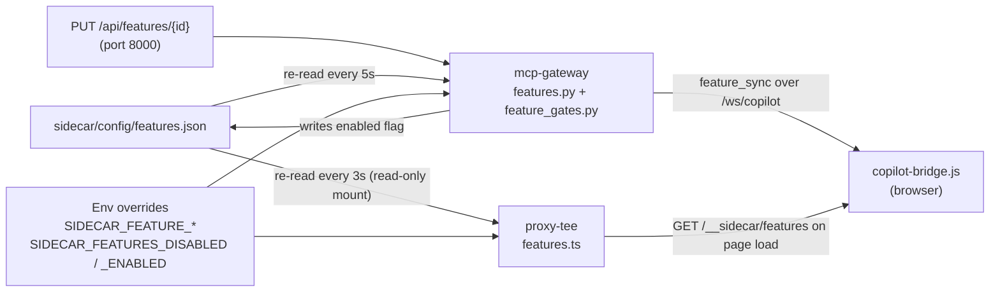

# Gods-Eye-View Sidecar: Feature Flags

Every sidecar feature can be switched on or off on its own. One file, [`sidecar/config/features.json`](../config/features.json), lists all features. Both `proxy-tee` and `mcp-gateway` read it and pick up edits without a restart.

---

## 1. How It Works



What a disabled feature does depends on where it lives:

| Where | Effect when disabled |
| :--- | :--- |
| Gateway REST route | Returns `403` with `{"error": "feature_disabled", "feature": "<id>", ...}` (CORS headers included). |
| MCP tool | Removed from the tool list (SSE, stdio and `/api/mcp/tools`). Calling it through `/api/tools/{name}` returns `403`. |
| Background engine | Stopped immediately; started again when re-enabled. |
| Alert channel | The dispatcher skips that channel; results show `false` for it. |
| `proxy-tee` route | Returns `403` (or `404` for the bridge script). |
| Data capture / polling | The response is still passed to the browser, but nothing is stored or polled. |
| Browser visuals | The bridge hides the layer (AOI rings, radar domes, escort bubbles/HUD, alert banners) and stops polling for it. |

---

## 2. Precedence

A feature's effective state is decided in this order:

1. **`SIDECAR_FEATURE_<ID>=true|false`**: a per-feature env override, e.g. `SIDECAR_FEATURE_COT_ATAK=false`.
2. **`SIDECAR_FEATURES_DISABLED` / `SIDECAR_FEATURES_ENABLED`**: comma-separated ID lists. If an ID is in both lists, disabled wins.
3. **`"enabled"` in `features.json`**: the normal, editable switch.
4. **Built-in default**: on, except `feature_admin_mcp`, which is off. This only applies if the file or entry is missing.

Then **dependencies** apply: a feature listed with `"requires": [...]` is only active when every required feature is active. For example, turning off `escort_bubbles` also turns off `escort_owntracks` and `traffic_vehicle_tagging`.

Features set by an environment variable are **locked**. Trying to change them through the API returns `409 Conflict` until the variable is removed.

---

## 3. Feature Catalog

**Restart?** shows whether the change takes effect while running (runtime) or only after the container restarts.

### Ingestion & Storage (`proxy-tee`)

| ID | Gates | Restart? |
| :--- | :--- | :--- |
| `ingest_flights` | Copying `/api/flights` into Tile38/TimescaleDB, and background flight polls | runtime |
| `ingest_military` | Copying `/api/military` | runtime |
| `ingest_vessels` | Copying `/api/vessels`, and background vessel polls | runtime |
| `ingest_wildfires` | Copying `/api/firms`, and background FIRMS polls | runtime |
| `ingest_satellite_tles` | Archiving `/api/celestrak/*` TLEs, and background CelesTrak polls | runtime |
| `history_archive` | All TimescaleDB writes (telemetry + TLEs). Tile38 keeps updating. | runtime |
| `headless_keepalive` | All background polling while no browser is active | runtime |
| `playback_replay` | `/__sidecar/playback`, `/api/replay` and replay interception (disabling it forces live data) | runtime |

### Browser & Mobile (`proxy-tee`)

| ID | Gates | Restart? |
| :--- | :--- | :--- |
| `ui_bridge_injection` | `<script>` injection into the upstream HTML and `/__sidecar/copilot-bridge.js` | runtime (reload page) |
| `mobile_gps_page` | `/gps`, `/mobile-gps` | runtime |
| `android_apk_download` | `/apk`, `/download/apk`, `/sentinel-gps.apk` | runtime |
| `https_listener` | HTTPS listener on `PROXY_HTTPS_PORT` (8443) | **restart** |

### Core (`mcp-gateway`)

| ID | Gates | Restart? |
| :--- | :--- | :--- |
| `mcp_sse_transport` | MCP over SSE at `/mcp/sse` (REST stays available) | **restart** |
| `upstream_tool_federation` | Re-exposing the upstream app's ~30 MCP tools | runtime |
| `anchor_resolution` | `resolve_anchor` | runtime |
| `scene_context` | `get_scene_context` | runtime |
| `entity_trajectory` | `get_entity_trajectory` | runtime |
| `satellite_passes` | `predict_satellite_passes` | runtime |
| `static_infrastructure` | `find_static_infrastructure` | runtime |
| `visual_cockpit` | `control_visual_cockpit` | runtime |
| `feature_admin_mcp` | `set_sidecar_feature` MCP tool (off by default) | runtime |

### Alerting & Notifications (`mcp-gateway`)

| ID | Gates | Restart? |
| :--- | :--- | :--- |
| `tripwire_sentinel` | The 20-second tripwire loop | runtime |
| `aoi_management` | `/api/aois`, `add_area_of_interest`, `toggle_aoi_perimeters`, AOI rings in the globe | runtime |
| `alert_api` | `/api/alerts/*`, `get_active_alerts`, `test_tactical_alert` | runtime |
| `notify_browser_hud` | Alert banners on the globe | runtime |
| `notify_desktop` | Browser desktop notifications | runtime |
| `notify_telegram` | Telegram delivery (still needs credentials) | runtime |
| `notify_discord` | Discord webhook delivery (still needs URL) | runtime |
| `notify_slack` | Slack webhook delivery (still needs URL) | runtime |
| `notify_alert_log` | Writing alerts to the `tactical_alerts` table | runtime |

### Analysis (`mcp-gateway`)

| ID | Gates | Restart? |
| :--- | :--- | :--- |
| `intsum_reports` | `/api/intsum/*`, `generate_intelligence_summary`, `dispatch_intelligence_summary` | runtime |
| `intsum_schedule` | The automatic 12-hour INTSUM (requires `intsum_reports`) | runtime |
| `kinematics_cpa` | `/api/kinematics/*`, CPA and conflict-scan tools | runtime |
| `pattern_of_life` | `/api/pol/*`, dark-contact and manoeuvre tools | runtime |
| `radar_horizons` | `/api/radar/*`, radar tools, 3D radar domes | runtime |

### Field Links (`mcp-gateway`)

| ID | Gates | Restart? |
| :--- | :--- | :--- |
| `sdr_ingest` | `/api/sdr/*` and SDR tools. Disabling stops a running stream; enabling does **not** auto-start it (use `start_sdr_stream`). | runtime |
| `cot_atak` | `/api/cot/*`, CoT tools, the UDP broadcaster, and alert forwarding to ATAK | runtime |
| `meshtastic_relay` | `/api/meshtastic/*`, mesh tools, the relay daemon, and alert forwarding over LoRa | runtime |

### Escort (`mcp-gateway`)

| ID | Gates | Restart? |
| :--- | :--- | :--- |
| `escort_bubbles` | `/api/escort/*`, escort tools, the escort engine, bubbles and HUD in the globe | runtime |
| `escort_owntracks` | `/api/escort/owntracks` webhook (requires `escort_bubbles`) | runtime |
| `traffic_vehicle_tagging` | `tag_traffic_vehicle` (requires `escort_bubbles`) | runtime |

`list_sidecar_features` and the `/api/features` endpoints are always available.

> **Feature flags vs `watchlists.json`:** `features.json` is the on/off switch. `watchlists.json` still holds each module's *settings* (AOIs, webhook URLs, CoT targets, Meshtastic region). A channel such as Telegram sends only when its feature is on **and** it is configured in `watchlists.json` or by env var.

---

## 4. Toggling Features

### Edit the file
Change `"enabled"` in `sidecar/config/features.json` and save. A boolean shorthand also works, e.g. `"cot_atak": false`. The gateway applies the change within `SIDECAR_FEATURES_RELOAD_SEC` (default 5s) and `proxy-tee` within `SIDECAR_FEATURES_RELOAD_MS` (default 3000ms). If the file is invalid JSON or an entry is neither an object nor a boolean, both services keep the last good version and report a `load_error`.

### REST API (gateway, `127.0.0.1:8000` only)
```bash
# List everything with effective state, locks and blocking dependencies
curl -s http://127.0.0.1:8000/api/features | jq '.features[] | {id, enabled, locked_by_env, blocked_by}'

# Inspect one feature
curl -s http://127.0.0.1:8000/api/features/cot_atak | jq .

# Disable / enable (persists to features.json)
curl -s -X PUT http://127.0.0.1:8000/api/features/cot_atak \
  -H "Content-Type: application/json" -d '{"enabled": false}' | jq .

# Force a re-read after editing the file
curl -s -X POST http://127.0.0.1:8000/api/features/reload | jq .
```
A `PUT` response lists every feature whose effective state changed, including dependents.

| Status | Meaning |
| :--- | :--- |
| `200` | Saved and applied (`restart_required: true` for `https_listener` / `mcp_sse_transport`) |
| `404` | Unknown feature ID |
| `409` | Locked by an environment variable |

### Read-only state (proxy, port 8080)
```bash
curl -s http://localhost:8080/__sidecar/features | jq .
```

### MCP tools
* `list_sidecar_features`: always available.
* `set_sidecar_feature(feature_id, enabled)`: only when `feature_admin_mcp` is on. It is off by default so assistants cannot re-enable things you switched off.

### Environment variables
Set them in your shell or `sidecar/.env.sidecar` before `docker compose up`:
```bash
SIDECAR_FEATURES_DISABLED=cot_atak,meshtastic_relay,sdr_ingest docker compose -f docker-compose.sidecar.yml up -d
```
`SIDECAR_FEATURES_DISABLED` and `SIDECAR_FEATURES_ENABLED` are already passed to both services. To use a per-feature `SIDECAR_FEATURE_<ID>` variable, add it to the service's `environment:` block in `docker-compose.sidecar.yml`.

---

## 5. Example Profiles

| Goal | Disable |
| :--- | :--- |
| **Minimal data recorder** | everything in Alerting, Analysis, Field Links and Escort; `ui_bridge_injection`, `mobile_gps_page`, `android_apk_download`, `https_listener` |
| **No outbound network chatter** | `notify_telegram`, `notify_discord`, `notify_slack`, `cot_atak`, `meshtastic_relay`, `traffic_vehicle_tagging` |
| **Save disk** | `history_archive` (or individual `ingest_*` layers) |
| **Save upstream API quota** | `headless_keepalive` |
| **Read-only AI assistant** | `visual_cockpit`, `alert_api`, `aoi_management`, `escort_bubbles`; keep `feature_admin_mcp` off |

---

## 6. Adding a New Feature

1. Add an entry to `sidecar/config/features.json` (`enabled`, `service`, `category`, `description`, optional `requires` / `restart_required`).
2. Gateway:
   * REST routes → add a prefix to `ROUTE_FEATURES` in `mcp-gateway/src/feature_gates.py`.
   * MCP tools → add each tool to `TOOL_FEATURES` in the same file. Any tool not listed is treated as an upstream federated tool.
   * Background engine → add the ID to `LIFECYCLE_FEATURES` and a branch in `apply_feature_state()` in `main.py`.
3. `proxy-tee` → check `features.isEnabled('<id>')` where needed.
4. Browser → check `featureOn('<id>')` in `copilot-bridge.js`.
5. Run the tests: `cd sidecar/mcp-gateway && python -m pytest`. The catalog test fails if a mapped tool's feature is missing from `features.json`.
