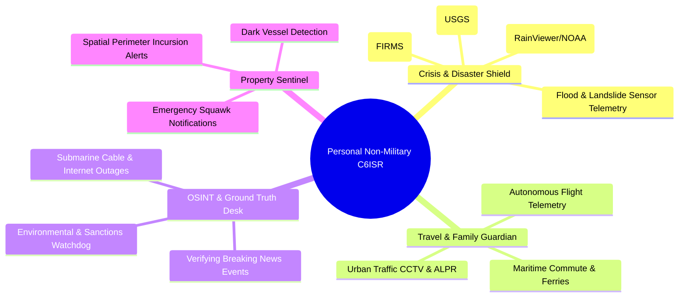
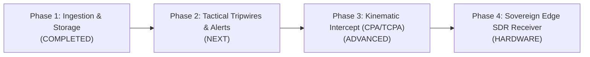

# Personal C6ISR: Concept, Architecture & Pragmatic Blueprint

> **A Low-Resource, Sovereign Situational Awareness & Intelligence Platform for Solo Technologists**

---

## 1. Executive Overview

**C6ISR** is a defense-industry acronym representing:
* **Command, Control, Communications, Computers, Cyber, Cognitive / Combat Systems, Intelligence, Surveillance, and Reconnaissance.**

While historically restricted to nation-states and multi-million-dollar Joint Operations Centers (JOCs), the modern convergence of **Open-Source Intelligence (OSINT)**, **Software-Defined Radios (SDR)**, **free Earth Observation satellites**, and **Large Language Models (LLMs)** allows a **single person** to operate a sovereign operational intelligence hub with near-zero financial cost.

This document outlines the philosophy, realistic boundaries, low-resource operating model, and civilian non-military applications of a **Personal C6ISR platform** built upon the Gods-Eye-View Sidecar.

---

## 2. Foundational Questions & Strategic Boundaries

### Question 1: What is the closest a solo person can get to personal C6ISR?

A solo individual will not own classified optical spy satellites, phased-array radars, or military kinetic systems. However, a single person today can achieve **80% to 90% of the situational awareness capabilities possessed by a year-2005 military operations center**:

1. **A Sovereign Tactical Sensor Bubble (Zero Internet Dependency):**
   * Using an inexpensive **$30 RTL-SDR radio dongle** and a small window/roof antenna, a local computer intercepts raw radio frequencies (1090MHz ADS-B and 162MHz maritime AIS).
   * This creates an unjammable, offline **250-mile radar perimeter** tracking all aircraft and coastal vessels even if the power grid or global internet fails.
2. **A Global 3D Multi-INT Common Operating Picture (COP):**
   * A unified photorealistic 3D globe (Cesium) aggregating air traffic, commercial shipping, orbital satellites, multispectral satellite imagery (Sentinel/Landsat), infrared wildfire thermal anomalies (FIRMS), and global seismic networks (USGS).
3. **A 4D Spatio-Temporal Memory Archive:**
   * A self-hosted temporal database (TimescaleDB) recording every coordinate fix over months, enabling forensic queries: *"Has this aircraft ever landed here before?"*, *"Show me all vessels that loitered in this bay last month."*
4. **An Autonomous AI Watch Officer (Claude / MCP):**
   * An autonomous agent monitoring spatial tripwires 24/7, detecting emergency squawk codes or route deviations, and dispatching high-priority alerts to your phone.

---

### Question 2: How can this be achieved with low resources and near-zero maintenance?

A personal C6ISR platform must **never become a full-time system administration burden** or an expensive cloud infrastructure project. The architecture is engineered around strict low-resource invariants:

* **Hardware Cost: $0 to $30**
  * **Zero Hardware Cost ($0):** Runs on your existing Mac, Linux PC, or laptop using public crowdsourced OSINT feeds.
  * **Optional Edge Sensor ($30):** One standard RTL-SDR USB dongle for offline local RF listening.
* **Monthly Cloud Bill: $0.00**
  * 100% self-hosted on local hardware via Docker Compose. No AWS, GCP, or SaaS recurring fees.
* **Storage Footprint: Self-Regulating & Strictly Capped**
  * **RAM Usage:** **< 1.5 GB total** across all containers (Tile38 in-memory cache is capped at ~25 MB via rolling TTLs).
  * **Disk Usage:** TimescaleDB automatic 24-hour columnar compression + 30-day retention naturally caps disk usage at **~4.5 GB to 5.5 GB total**.
  * **Static Geobase:** 44,000+ global facilities stored permanently in **only 30 MB** of PostGIS storage.
* **Maintenance Overhead: Zero-Touch**
  * No manual database defragmentation. Containers auto-recover and self-heal.
  * Single command to run: `docker compose -f docker-compose.sidecar.yml up -d`.
  * Single command to update: `git pull`.

---

### Question 3: What does a NON-MILITARY personal C6ISR look like?

For civilians, researchers, disaster responders, and technologists, C6ISR is not about weapons. It is about **hyper-awareness, personal safety, crisis resilience, and empirical ground truth**.

#### 1. The Personal Disaster & Crisis Shield
* **Wildfire Early Warning:** Tracking NASA FIRMS thermal infrared detections and fire containment polygons days before local news broadcasts them.
* **Seismic Telemetry:** Instant USGS magnitude, depth, and epicentral distance calculations when a tremor occurs.
* **Severe Weather & Fronts:** Real-time Doppler precipitation radar, convective storm fronts, and cyclone path cones in 3D.
* **Flood / Hydrology Sensors:** Monitoring river catchment telemetry for flash flood hazards.

#### 2. The Travel, Logistics & Family Guardian
* **Autonomous Flight Radar:** Tracking flights with raw ADS-B transponder telemetry (ground speed, descent rate, holding patterns) without ads or paywalls.
* **Maritime Commute & Coastal Monitoring:** Monitoring local ferries, shipping container bottlenecks, or recreational anchorages.
* **Urban Commute Intelligence:** Synthesizing public DOT traffic cameras, highway ALPR density, and TomTom flow speeds to spot gridlock before leaving home.

#### 3. The Investigative OSINT & Ground Truth Desk
* **Verifying Breaking News:** When geopolitical crises or industrial accidents occur, inspecting raw satellite imagery and active transponders directly.
* **Environmental & Maritime Watchdog:** Detecting unauthorized industrial burns or illegal fishing in marine sanctuaries.
* **Infrastructure Resilience:** Correlating national internet disruptions with subsea fiber-optic cable strikes or anchor drags.

#### 4. The Digital Nomad / Remote Property Sentinel
* **Geofenced Tripwires:** Setting an automated boundary around a farm, home, or cabin. If a low-flying aircraft circles within 3km or a fire hotspot appears within 25km, an instant alert is pushed to your mobile device.

---

## 3. C6ISR Functional Mapping Matrix

| C6ISR Pillar | Military Doctrine Definition | Personal Non-Military Implementation |
| :--- | :--- | :--- |
| **Command (C1)** | Joint Staff & Rules of Engagement | **Your Objectives / Family Safety Priorities / Autonomous Agent Policies** |
| **Control (C2)** | Asset Tasking & Weapon Steering | **3D Cesium Globe Navigation, Camera Locks & Layer Controls** |
| **Communications (C3)** | Tactical Data Links & SATCOM | **Local WebSockets, Dual-Transport MCP, and Telegram / Webhook Alerts** |
| **Computers (C4)** | Hardened Tactical Data Centers | **Local Docker Stack (TimescaleDB + Tile38 + PostGIS + FastAPI)** |
| **Cyber (C5)** | Offensive / Defensive Network Ops | **Submarine Cable & Datacenter Mapping, GPS Jamming Detection** |
| **Cognitive (C6)** | Target Intercept & Kill Chains | **Kinematic CPA / TCPA Collision Vectors & Spatial Anomaly Detection** |
| **Intelligence (I)** | Multi-INT (SIGINT / GEOINT / MASINT)| **Public Multi-INT (ADS-B, AIS, FIRMS, USGS, Sentinel-2, CCTV, ALPR)** |
| **Surveillance (S)**| Persistent Military Reconnaissance | **24/7 Automated Background Harvester & In-Memory Spatial Tripwires** |
| **Reconnaissance (R)**| Post-Strike Damage Assessment | **Historical 4D Telemetry Replay & Trajectory Pattern-of-Life Analysis** |

---

## 4. Phased Implementation Roadmap

### Phase 1: Multi-INT Ingestion & Storage (Completed in `v1.3.0-sidecar`)
* ✅ 24/7 Headless background feed harvester (Flights, Vessels, Fires, Satellites).
* ✅ Sub-millisecond hot in-memory spatial geofencing in Tile38.
* ✅ Compressed 4D historical telemetry archive in TimescaleDB (30-day rolling).
* ✅ Permanent PostGIS infrastructure geobase (44,131 datacenters, dams, cables, military bases in 30 MB).
* ✅ 36 unified tools federated into Claude Desktop via MCP.

### Phase 2: Autonomous Tripwires & Alert Bus (Next Step)
* 🔲 Tile38 `FENCE ROAM` detecting geographic perimeter breaches around points of interest.
* 🔲 Transponder anomaly triggers (Squawk `7700` Emergency, `7600` Radio Loss, `7500` Unlawful Interference).
* 🔲 Automated notification bridge (Telegram Bot, Discord Webhook, or local macOS notification).

### Phase 3: Kinematic Intercept & Anomaly Engine
* 🔲 Closest Point of Approach (CPA) and Time-to-CPA (TCPA) relative motion calculations.
* 🔲 3D radar and surface-to-air missile (SAM) range fan projection domes in Cesium.
* 🔲 Dark vessel detection (vessels vanishing from AIS near territorial chokepoints).

### Phase 4: Sovereign Edge RF Hardware ($30 RTL-SDR Dongle)
* 🔲 USB RTL-SDR integration running `dump1090` (1090MHz ADS-B) and `rtl-ais` (162MHz VHF).
* 🔲 Direct ingest pipe into Tile38/TimescaleDB, providing unjammable, offline radar tracking independent of third-party APIs.
