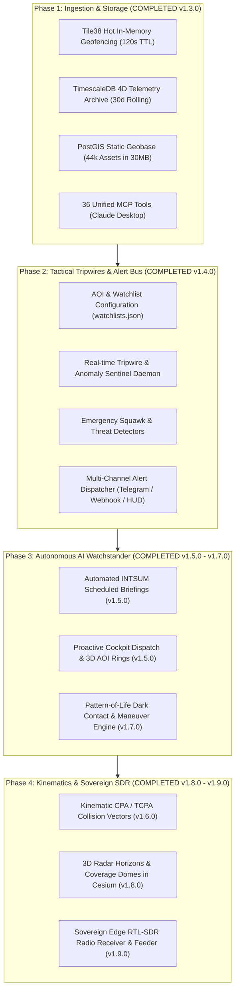

# Implementation Plan: Personal Intelligence Platform (Personal C6ISR)

> **Extending Gods-Eye-View Sidecar into an Autonomous Situational Awareness & Alerting Sentinel**

---

## 1. System Vision & Objective

Transform the current Gods-Eye-View Sidecar from a **reactive query engine** (where Claude only responds when asked) into a **proactive, autonomous personal intelligence sentinel** that:
1. Continuously monitors your Areas of Interest (AOIs) and Watchlisted Entities (EOIs).
2. Detects spatial, kinematic, and disaster anomalies in real time.
3. Dispatches instant alerts to your phone (Telegram / Webhooks) when critical thresholds are breached.
4. Generates scheduled Intelligence Summaries (INTSUM) without requiring user prompts.
5. Retains a sovereign, offline-capable radar bubble via low-cost Software-Defined Radio (SDR).

---

## 2. Phased Architecture & Execution Roadmap

---

## 3. Phase 2: Tactical Tripwires & Alert Bus (Immediate Focus)

### Milestone 2.1: Watchlist & AOI Registry
Create a clean, human-editable configuration (`sidecar/config/watchlists.yml` or database table) defining your personal watch boundaries:
* **Areas of Interest (AOIs):**
  * Home / Family Cities (e.g. San Francisco, Tokyo, London with custom radius).
  * Travel destinations, properties, or critical infrastructure nodes.
* **Entities of Interest (EOIs):**
  * Specific flight numbers / callsigns (family flights, medical transport, VIP).
  * Vessel MMSIs (local ferries, supply ships).
  * Space objects (ISS, Starlink passes).

### Milestone 2.2: Real-time Anomaly & Event Detectors
Build an event evaluation daemon inside `sidecar/proxy-tee` or `mcp-gateway` evaluating telemetry as it streams in:
1. **Transponder Emergency Codes:**
   * Squawk `7700` (General In-Flight Emergency).
   * Squawk `7600` (Radio Communications Failure).
   * Squawk `7500` (Unlawful Interference / Hijack).
2. **Low-Altitude Airspace Incursions:**
   * Aircraft descending below 1,500m within 10km of an AOI or critical infrastructure (nuclear plants, datacenters).
3. **Disaster Proximity Tripwires:**
   * USGS Earthquake $\ge$ M4.5 within 200km of an AOI.
   * NASA FIRMS Wildfire thermal anomaly within 30km of an AOI.
   * NOAA Tropical Cyclone center projected towards an AOI.
4. **Subsea Infrastructure Threat:**
   * Commercial vessels moving at $<1.0\text{ knot}$ (anchoring / dragging) within 500m of a mapped fiber-optic cable.

### Milestone 2.3: Multi-Channel Alert Bus
A unified dispatcher sending structured alerts:
* **Telegram Bot:** Direct messages to your phone with location coordinates, contact details, and a one-click link to open God's Eye View centered on the incident.
* **Discord / Slack Webhooks:** Dedicated `#tactical-alerts` channel.
* **Local OS Notifications:** Native macOS notifications via `osascript`.

---

## 4. Phase 3: Autonomous AI Watchstander (Agentic Loop)

### Milestone 3.1: Scheduled Intelligence Summary (INTSUM)
* A background cron worker in `mcp-gateway` (e.g., every 2 hours or every morning at 08:00):
  1. Queries TimescaleDB and Tile38 for all activity across your AOIs over the preceding window.
  2. Synthesizes an executive **INTSUM Dossier** (air traffic density, weather changes, seismic events, infrastructure status).
  3. Formats it in concise markdown and pushes it to your Telegram / Discord.

### Milestone 3.2: Automated Cockpit Reaction
* When a high-severity alert triggers (e.g. Squawk 7700 or M5.0+ earthquake), the gateway dispatches a command over `/ws/copilot` to:
  * Fly the active browser Cesium globe to the event coordinates.
  * Turn on relevant data layers (e.g. earthquakes, weather radar).
  * Flash an alert banner on the HUD.

### Milestone 3.3: Pattern-of-Life (PoL) Analytics
* Detect "Dark Vessels": Marine vessels that cease broadcasting AIS transmissions inside territorial chokepoints.
* Track route deviations: Aircraft departing substantially from standard flight corridors.

---

## 5. Phase 4: Kinematics & Sovereign Hardware SDR

### Milestone 4.1: Intercept & Collision Kinematics (CPA / TCPA)
* Implement vector geometry calculating:
  * **CPA (Closest Point of Approach):** Minimum predicted distance between moving entities.
  * **TCPA (Time to CPA):** Estimated time in seconds until point of closest approach.

### Milestone 4.2: 3D Engagement & Sensor Range Domes
* Project visual 3D radar domes and observation envelopes around airports and naval stations in Cesium.

### Milestone 4.3: Sovereign Edge SDR Radio Receiver ($30 USB Dongle)
* Connect an RTL-SDR USB dongle running a lightweight container with `dump1090-fa` (1090MHz ADS-B) and `rtl-ais` (162MHz VHF).
* Feed raw radio packets directly into Tile38/TimescaleDB.
* **Outcome:** Your system tracks air and maritime traffic within 200+ miles completely offline, with zero reliance on external APIs or internet connectivity.

---

## 6. Implementation Deliverables & Release Ledger

All roadmap phases have been fully implemented, verified, and released under semantic tags:

| Version | Milestone | Key Deliverables | Tool Count |
| :--- | :--- | :--- | :--- |
| **`v1.3.0-sidecar`** | Phase 1 (Ingestion & Storage) | Tile38 Hot Cache, TimescaleDB 4D Archive, PostGIS Geobase, Co-Pilot WebSocket Bridge | 36 Tools |
| **`v1.4.0-sidecar`** | Phase 2 (Tactical Tripwires & Alerts) | Bangalore Default AOI, Sentinel Evaluation Daemon, Unified Multi-Channel Dispatcher (HUD, Telegram, Discord, Slack) | 40 Tools |
| **`v1.5.0-sidecar`** | Phase 3.1 & 3.2 (Autonomous Watchstander) | Automated 12h INTSUM Briefings, 3D Glowing Cyan AOI Rings & Badges in Cesium | 42 Tools |
| **`v1.6.0-sidecar`** | Phase 4.1 (Kinematic CPA / TCPA Vectors) | 4D CPA / TCPA Collision Vectors, Proximity Separation Conflict Scanner | 44 Tools |
| **`v1.7.0-sidecar`** | Phase 3.3 (Pattern-of-Life Anomaly Engine) | Dark Contact Transponder Silence Detector, Flight Maneuver Anomaly Detector | 46 Tools |
| **`v1.8.0-sidecar`** | Phase 4.2 (Radar Coverage Horizons) | 4/3 Earth Radius Horizon Physics, 3D Sensor Range Domes, Concentric Rings & Azimuth Radials in Cesium | 50 Tools |
| **`v1.9.0-sidecar`** | Phase 4.3 (Sovereign Edge SDR Radio Ingestion) | RTL-SDR Radio Ingestion Pipeline (Mode-S 1090MHz / AIS 162MHz), Feeder Container, Sovereign RF Offline Tracking | **55 Tools** |
